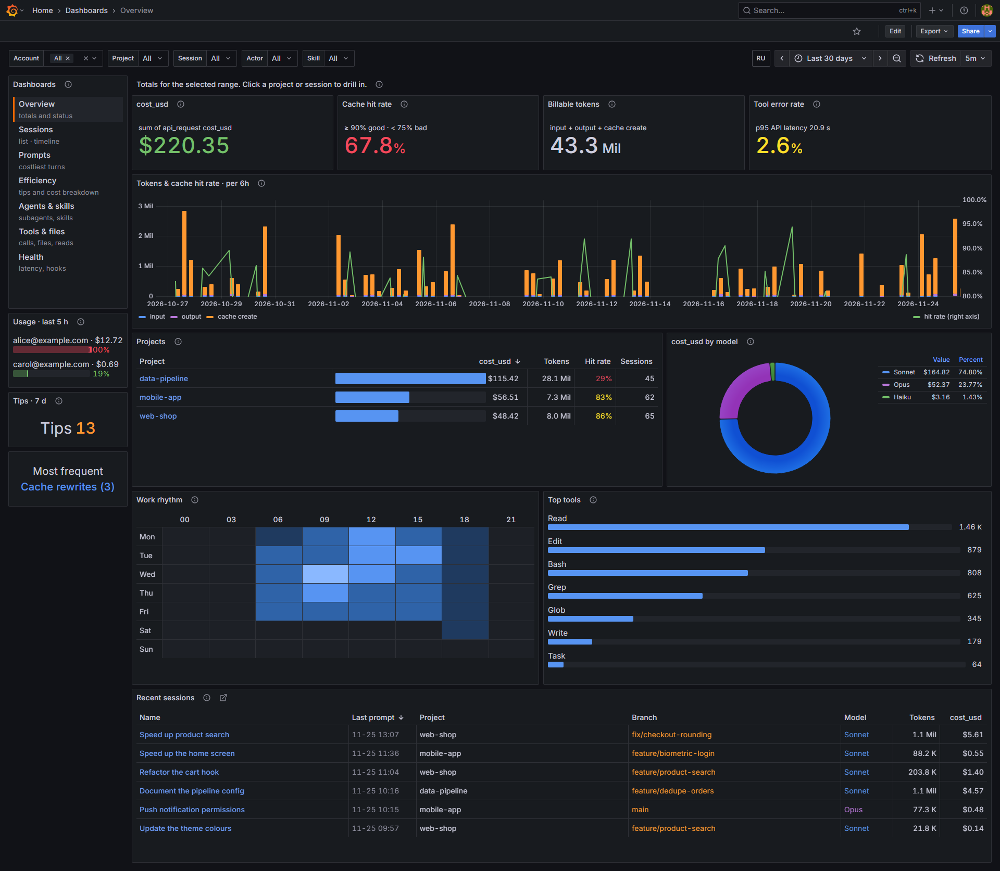
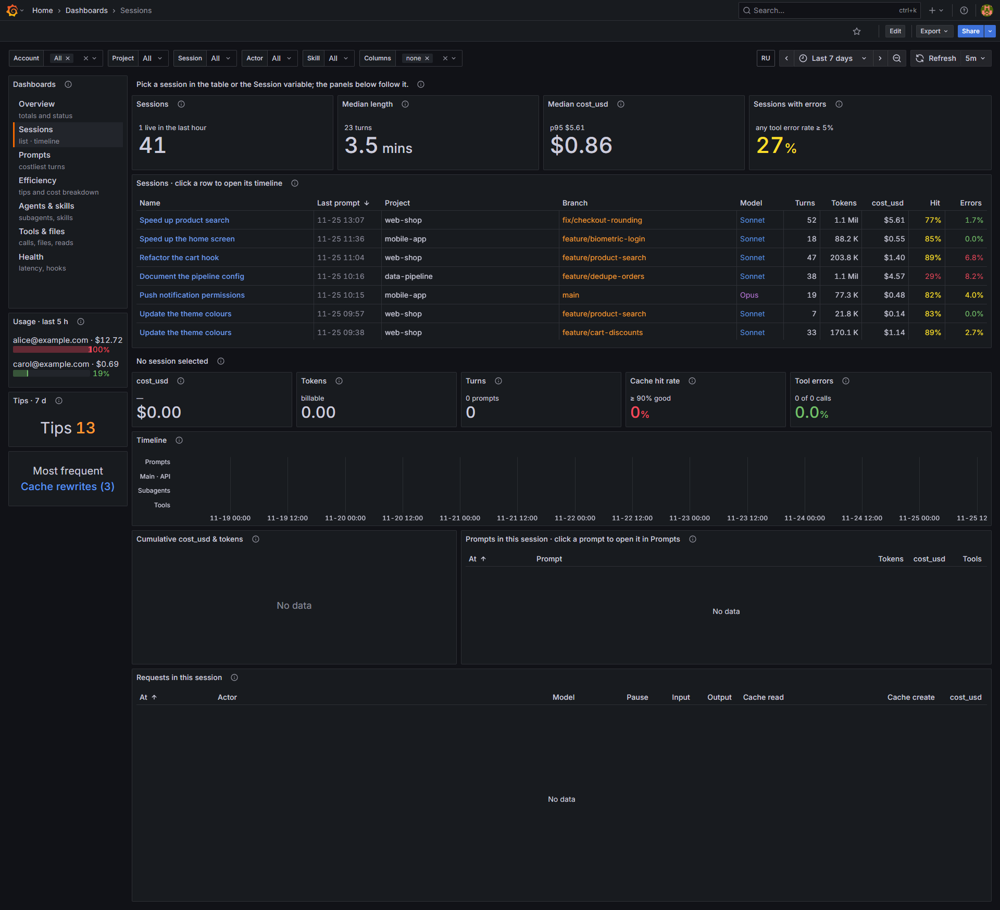
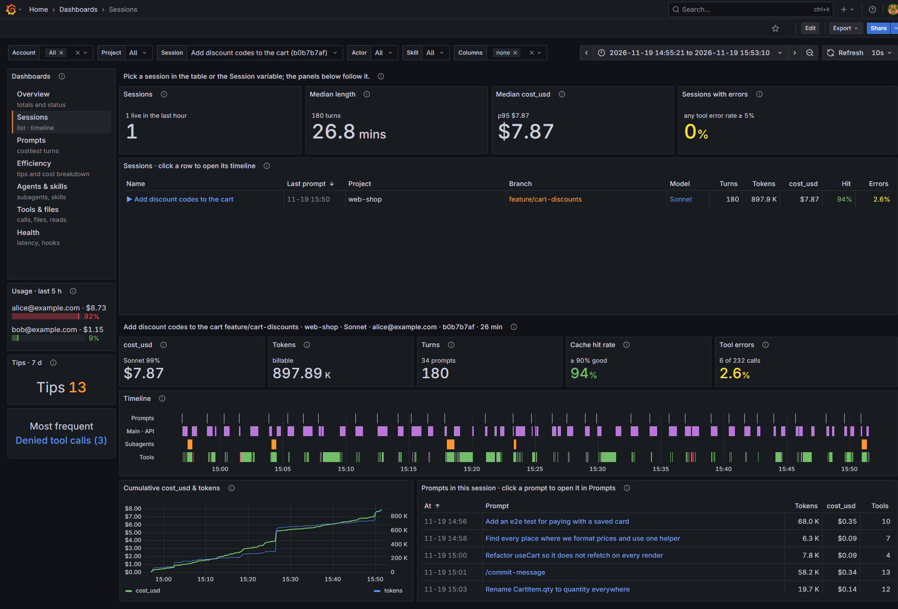
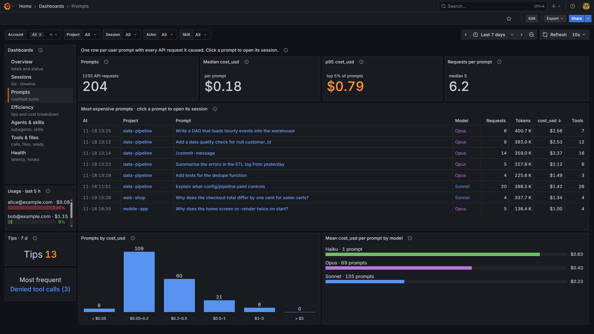
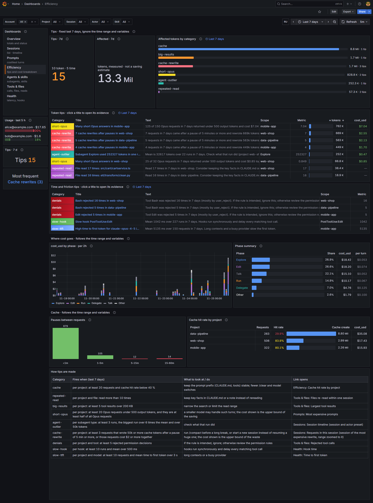
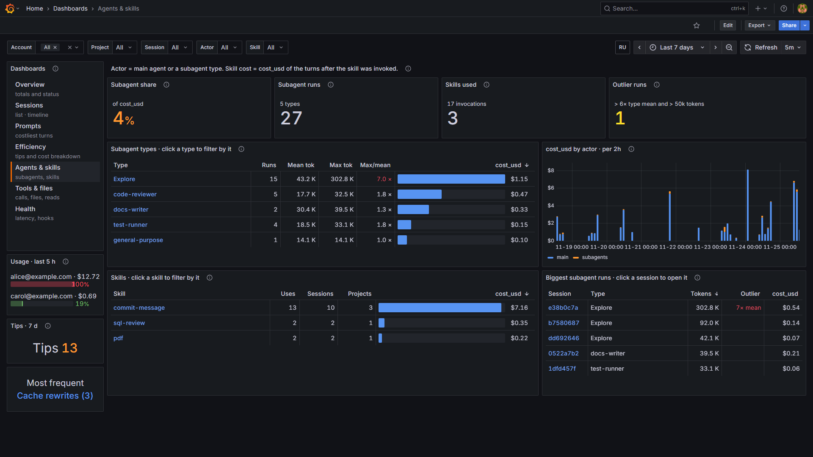
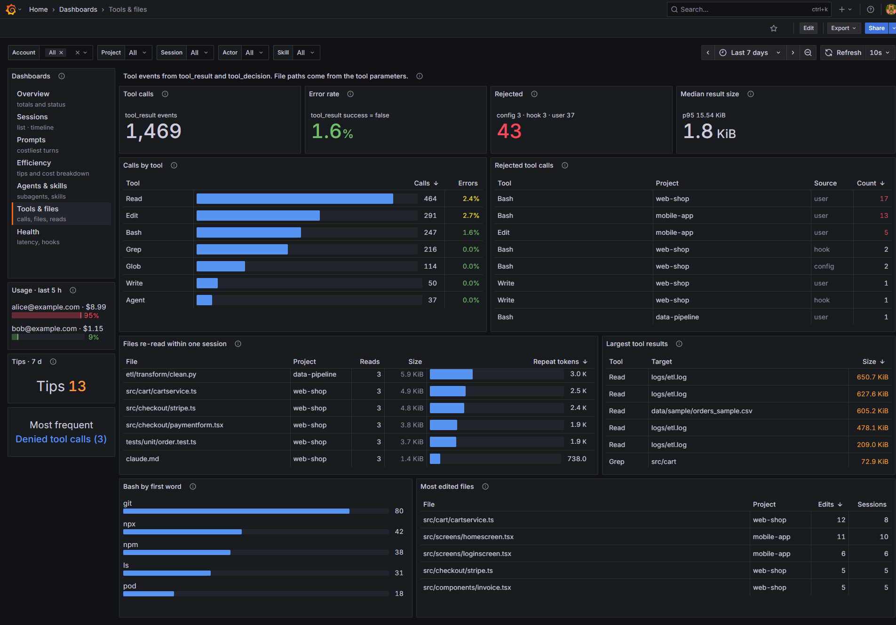
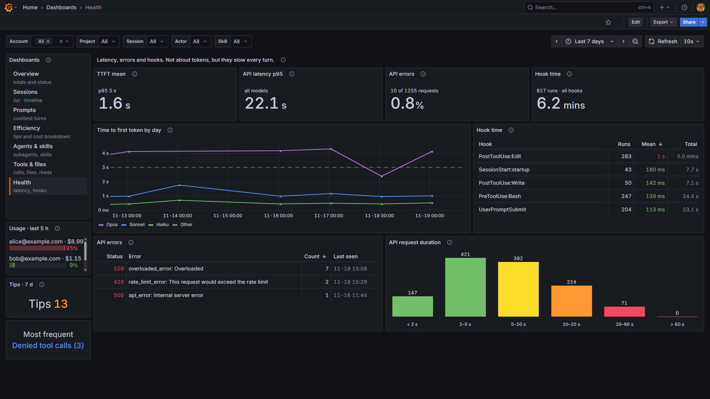

# Read the dashboards

Grafana shows seven dashboards. This page explains what is on them, what the variables and the
time range do, and what a click opens. The screens are laid out for Full HD (1920 px wide) and
wider; narrower screens are not supported.

!!! note "Panel titles"
    The tables on this page use the titles of the English dashboards; the Russian page uses the
    titles of the Russian copies, see
    [Russian dashboards](#russian-dashboards). Some titles end in a hint such as
    `· click a type to filter by it`; the tables below leave that tail out and describe the click
    in their own column.

The screenshots on this page show made-up demo data.

---

## Open Grafana

Open `http://localhost:3000` on the server PC, or `http://<server-ip>:3000` from another PC (with
your `GRAFANA_PORT` if you changed it). Log in as `admin`; the password is
`GRAFANA_ADMIN_PASSWORD` in the `.env` file of the `cc-telemetry` folder, see
[the server page](server.md#check-that-it-works). **Overview** is the home page. It is empty until
the first events arrive.

---

## Russian dashboards

Every dashboard has a Russian copy with the same panels, in the Grafana folder `ru`. The English
dashboards stay in the General folder, and the home page stays the English **Overview**.

| What | Behaviour |
| --- | --- |
| Switch | The **RU** button in the controls row at the top opens the Russian copy; **EN** on the copy leads back. Both keep the time range and all variables |
| Links | The rail, the drill-down clicks and the tip links stay in the language you are in |
| Translated | The rail, variable labels and **Columns** options, panel and tile titles, descriptions, column headers, "no data" and value texts, and labels built in SQL |
| Not translated | Session titles and other collected data; Grafana's own interface (`All`, menus, units); tip titles and texts, which come from `cc.tips`; terms such as `cost_usd`, TTFT and p95; tool and model names |

The copies are generated from the English files; do not edit them in Grafana. After you update an
older server, Grafana must restart once to pick up the `ru` folder: `--update` on Linux does it,
on Windows follow [the update steps](maintenance.md#windows).

---

## The side rail

The left 3 of 24 columns on every dashboard are the rail. Its panels have a fixed height, so the
space under them stays empty.

| Panel | What it shows | What a click does |
| --- | --- | --- |
| **Dashboards** | The seven dashboards; the current one is highlighted | Opens that dashboard and keeps the time range and the variables |
| **Usage · last 5 h** | One bar per Claude account: the cost of the last 5 hours as a share of that account's highest 5-hour cost in the last 30 days. Green below 60 %, yellow from 60 %, red from 80 %. Accounts with no cost in the last 7 days are not listed | Nothing |
| **Tips · 7 d** | The number of [tips](tips.md) | Opens the Tips section of **Efficiency** |
| (the tile under it, no title) | The most frequent tip category with its count in brackets; ties go alphabetically; `none` without tips | Opens the Tips section of **Efficiency** |

The rail ignores the time range and the variables: its windows are fixed (5 hours against the
last 30 days, and 7 days).

---

## Variables

Five variables at the top are shared by every dashboard and nested: each one lists only what is
left after the ones to its left. `All` means no filter. They are kept when you switch
dashboards through the rail.

| Variable | What it filters | Notes |
| --- | --- | --- |
| **Account** | The Claude account | Multi-select. Shows the e-mail of the account, or the first 8 characters of its id when there is no e-mail. Events without an account show only under `All` |
| **Project** | The project | The label or the guess described on [the clients page](clients.md#project) |
| **Session** | One session | Shows `title (short id)`, or the full id while the session has no title. Lists the newest 300 sessions that made a model request |
| **Actor** | Who made the request | `main` is the main session, an agent name (`developer`, `Explore`, ...) is a subagent, `aux:*` are Claude Code's own service requests |
| **Skill** | The skill in use | A tool call belongs to a skill through the `request_id` of the model request that carried the skill name. Claude Code does this attribution itself; the label lasts until the end of the prompt in which the skill was invoked |

**Sessions** adds one more control, **Columns**: it shows the extra columns Session ID, Started
and Account of the sessions table, none by default.

Not every panel follows every variable:

| Panel | Ignores |
| --- | --- |
| The rail | The time range and all variables |
| The Tips section of **Efficiency** | The time range and all variables: tips are fixed to the last 7 days |
| **Recent sessions** on **Overview** | Actor and Skill; it shows whole-session tokens and cost |
| The sessions table and its four totals on **Sessions** | The Session variable, so the selected row stays among the others |
| The two **Hook time** panels on **Health** (the total and the table) | Skill: hook events carry no skill |

Two more cases are not "ignore" but "empty": **Skills used** and **Skills** on **Agents & skills**
show nothing while an agent is picked as Actor, because only the main session reports skill
activations; and the panels below the header on **Sessions** say "No session selected" until you
pick a session.

---

## Time range and refresh

| Setting | Value |
| --- | --- |
| Default range | Last 24 hours |
| Quick ranges | 5 minutes, 1 hour, 24 hours, 7 days, 30 days and `All` (10 years) |
| Refresh | Every 5 minutes by default; pick another rate at the top right, from 1 minute to 1 hour |
| Days and hours | Server time zone, which is UTC in Docker |

The time range applies to every panel except the rail and the tips. A panel that ignores it says
so in its description (hover the `i` in its corner).

---

## Clicks

A panel title that ends in "click a ... to ..." says what a click does. The table lists every
link; [tips](tips.md) open their own evidence panels.

| Dashboard | You click | What opens |
| --- | --- | --- |
| **Overview** | A session name in **Recent sessions** | That session on **Sessions**, with the range zoomed to it |
| **Overview** | **all →** next to the **Recent sessions** title | **Sessions** with the current range and variables |
| **Overview** | A project in **Projects** | **Overview** filtered by that project; Session, Actor and Skill reset to `All` |
| **Sessions** | A session name in the **Sessions** table | That session below the table, range zoomed to it; Actor and Skill are kept |
| **Sessions** | A prompt in **Prompts in this session** | **Prompts**, filtered by that session; the range stays, Actor and Skill reset to `All` |
| **Prompts** | A prompt in **Most expensive prompts** | Its session on **Sessions**, range zoomed to it; Actor and Skill reset to `All` |
| **Prompts** | A project in **Most expensive prompts** | **Prompts** filtered by that project; Account and Session are kept, Actor and Skill reset to `All` |
| **Agents & skills** | An agent type in **Subagent types** | **Agents & skills** filtered by that type (Actor) |
| **Agents & skills** | A skill in **Skills** | **Agents & skills** filtered by that skill (Skill) |
| **Agents & skills** | A session in **Biggest subagent runs** | That session on **Sessions**, range zoomed to it; Actor and Skill reset to `All` |
| **Efficiency** | A tip title in **Token tips** or **Time and friction tips** | The evidence panel full-screen, see [Tips](tips.md#where-the-links-lead) |
| every dashboard | The two tips tiles in the rail | The Tips section of **Efficiency** |

**The zoom rule.** Opening a session from a session name (**Recent sessions**, **Sessions**),
from a prompt in **Most expensive prompts** or from **Biggest subagent runs** also sets the time
range to that session: from its first prompt, request or tool call to the end of its last one,
padded by 3 % of that span on each side, at least 5 seconds each. The timeline and the cumulative
graph then fill their width, and the sessions table and its four totals list the sessions active
in that window. The browser Back button or the time picker returns you to the earlier range.
Picking a session in the Session variable does not zoom: narrow the range yourself.

---

## Overview

**Question:** what did I spend, and how well did the cache work, in this period?

| Panel | Shows | Click |
| --- | --- | --- |
| **cost_usd** | The sum of `cost_usd` of the API requests in the range | - |
| **Cache hit rate** | See the definitions below. Per project: **Cache hit rate by project** on **Efficiency** | - |
| **Billable tokens** | Input + output + cache-create tokens | - |
| **Tool error rate** | The share of failed tool calls: below 2 % green, 2 % and above yellow, 5 % and above red. The second line is the 95th percentile of the API request duration | - |
| **Tokens & cache hit rate** | Bars (left axis): input, output and cache-create tokens per time bucket; about 100 buckets per time range, at least 5 minutes each (15 minutes over 24 hours, 2 hours over 7 days, 6 hours over 30 days). A bar starts at its bucket time and covers the bucket; the panel title ends with the bucket length (`per 15m`) and the tooltip header is the bucket start. Line (right axis, 80-100 %): the cache hit rate of the bucket; a lower value is clipped. Cache reads are not drawn: they are 10-100 times larger and would flatten the bars | - |
| **Projects** | Per project: `cost_usd`, billable tokens, cache hit rate, sessions. `unknown` means the project could not be determined | Filters **Overview** by the project |
| **cost_usd by model** | The share of `cost_usd` by model family (Opus, Sonnet, Haiku; Other is any other name); the legend shows the share and the dollars | - |
| **Work rhythm** | Requests by weekday (rows) and 3-hour block (columns `00`, `03`, ... `21`). A cell is brighter the closer it is to the busiest cell. It is a table with coloured cells because the Grafana heatmap cannot put the time of day on its X axis | - |
| **Top tools** | The 7 tools with the most calls | - |
| **Recent sessions** | The six sessions with the latest prompt: name, model, tokens, `cost_usd` of the whole session | A name opens the session; **all →** opens **Sessions** |

| Term | Meaning |
| --- | --- |
| `cost_usd` | Computed by Claude Code from API prices, so the sum is not a bill: on a subscription you pay the flat fee |
| Billable tokens | Input + output + cache create. Cache reads are left out: they cost a fraction of a normal token |
| Cache hit rate | cache read / (cache read + input + cache create). 90 % and above is green, 75 % and above yellow, below red |

---

## Sessions

**Question:** what happened in one session: its prompts, requests, subagents and tools over time?

The top part lists sessions and ignores the Session variable; everything below it is about the
one session you select. Pick it by a click on a name in the table or in the Session variable.

| Panel | Shows | Click |
| --- | --- | --- |
| **Sessions** (the first tile) | Sessions with a model request and a prompt in the range. The line above the number: sessions whose last event is within the last hour | - |
| **Median length** | The median session length as activity time; the line above: the median number of turns | - |
| **Median cost_usd** | The median `cost_usd` of a whole session; the line above: the 95th percentile | - |
| **Sessions with errors** | The share of those sessions in which at least 5 % of the tool calls failed. Whole sessions, not only the range | - |
| **Sessions** (the table) | One row per session, newest last prompt first, 500 at most: name (title, else the first prompt), last prompt, project, git branch, model with the highest cost, turns, tokens, `cost_usd`, cache hit rate, tool errors. The selected row has a ▶ before its name. Session ID, Started and Account are hidden until you pick them in **Columns** | A name selects the session and zooms the range |
| (the header) | Name and branch, project, model with the highest cost, account, short id, activity time, and `LIVE` when the last event is under 10 minutes old | - |
| **cost_usd** | `cost_usd` of the session; the line above: the model family with the highest cost and its share | - |
| **Tokens** | Billable tokens of the session | - |
| **Turns** | Model requests of the session, subagents and auxiliary requests included; the line above: the distinct prompts that caused them | - |
| **Cache hit rate** | The cache hit rate of the session | - |
| **Tool errors** | Failed tool calls / tool calls: below 2 % green, 2 % yellow, 5 % and above red | - |
| **Timeline** | One cell per time step of the range; see below | - |
| **Cumulative cost_usd & tokens** | The running total over the session, one step per model request: `cost_usd` on the left axis (green), billable tokens on the right (blue) | - |
| **Prompts in this session** | The prompts of the session, oldest first: tokens and tool calls | A prompt opens it in **Prompts** |

| Term | Meaning |
| --- | --- |
| Activity time (session length) | The time a model request or tool call was running. Idle time between them is not counted, and overlapping requests and tool calls count once |
| Turn | A model request, subagent and auxiliary requests included |
| `LIVE` | The last event of the session is under 10 minutes old |

**Reading the timeline.** The lanes are Prompts (a prompt marks one step; shown only with Actor
and Skill set to `All`), Main · API (a request of the main agent was running), Subagents (from
the first to the last request of a subagent) and Tools (green: all calls ok; red: at least one
call failed in that step). Claude Code logs a request or a tool call when it ends, so the bar
runs back from that moment by its duration. With a wide range the bars get thin: click the
session in the table to zoom.

The prompt text shows only when the client sets `OTEL_LOG_USER_PROMPTS=1`; otherwise the panels
say `(text not logged)`.

---

## Prompts

**Question:** which prompts cost the most, and what does a typical prompt cost?

A prompt is a user message and every API request until the next user message (subagent and
auxiliary requests included); its `cost_usd` is the sum over those requests. The panels follow the
range (by the time of the prompt) and all variables; with Actor or Skill set, only prompts with
such a request are counted, at their full cost.

| Panel | Shows | Click |
| --- | --- | --- |
| **Prompts** | Prompts in the range that caused at least one API request; the line above: the API requests | - |
| **Median cost_usd** | The median `cost_usd` of a prompt | - |
| **p95 cost_usd** | The 95th percentile: 5 % of the prompts cost more | - |
| **Requests per prompt** | The mean number of API requests per prompt; the line above: the median | - |
| **Most expensive prompts** | The 8 prompts with the highest `cost_usd`: prompt text, project, model (the one with the highest cost within the prompt), requests, tokens, tools | A prompt opens its session on **Sessions**; a project filters **Prompts** |
| **Prompts by cost_usd** | The number of prompts per bucket: < $0.05, $0.05-0.2, $0.2-0.5, $0.5-1, $1-3, > $3 | - |
| **Mean cost_usd per prompt by model** | The mean `cost_usd` of a prompt per model family; a prompt counts for the family with the highest cost within it. The name shows how many prompts the mean is over | - |

---

## Efficiency

**Question:** where are tokens and money lost, and which tips apply to my work?

The page has three parts. The Tips section on top reads the [tips](tips.md): fixed to the last 7
days, no time range, no variables. The "Where cost goes" and "Cache" sections below follow the
time range and the variables.

| Panel | Shows | Click |
| --- | --- | --- |
| **Tips · 7d** | The number of tips, then how many are about tokens and how many about time (denials, slow hooks, slow first token). The rail calls its twin **Tips · 7 d** | - |
| **Affected · 7d** | The sum of the tokens the tips refer to; an estimate of scale, not of a saving | - |
| **Affected tokens by category** | The same sum per category, biggest first; time tips have no value and are not shown | - |
| **Token tips** | The tips about tokens, biggest first: category, title, affected tokens, `cost_usd` | A title opens the evidence panel |
| **Time and friction tips** | The tips without a token value (denials, slow hooks, slow first token) | A title opens the evidence panel |
| **cost_usd by phase** | Stacked bars: `cost_usd` per time bucket, split by the work phase of the response. Buckets follow the time range (about 100, at least 5 minutes each: 15 minutes over 24 hours, 2 hours over 7 days, 6 hours over 30 days). A bar starts at its bucket time and covers the bucket; the panel title ends with the bucket length (`per 15m`) and the tooltip header is the bucket start | - |
| **Phase summary** | The same phases: share of the range's `cost_usd` and `cost_usd` per model request | - |
| **Pauses between requests** | A bar chart of the gaps between consecutive model requests of the same session and agent. Past 5 minutes it is red | - |
| **Cache hit rate by project** | Per project: requests, cache hit rate, cache-creation tokens (what a low hit rate costs), `cost_usd` | - |
| **How tips are made** | The rules table, the same as on [the Tips page](tips.md#the-rules) | - |

| Term | Meaning |
| --- | --- |
| Work phase | Decided by the tools a response called, first match wins in this order: Edit (any `Edit`, `Write`, `MultiEdit`, `NotebookEdit`), Delegate (`Task`, `Agent`, `SendMessage`, `SubagentHandback`, `TaskStop`), Run (`Bash`), Explore (only `Read`, `Grep`, `Glob`, `LS`), Other (any other tools, for example MCP, web or `Skill`). A response with no tool result is Talk: a plain answer, or a tool call whose result was never recorded |
| Pause over 5 minutes | Past the prompt-cache lifetime the next request writes the cache again instead of reading it |
| Gap | To the previous request of the same session and the same agent: the main conversation (with its auxiliary requests) and each subagent are counted separately, gaps between main and subagent requests are not counted. The previous request is looked up in the whole session history, so the pause before the first request in the range is included; a subagent's first request is not a pause |

---

## Agents & skills

**Question:** how much do subagents and skills cost, and which runs are outliers?

| Panel | Shows | Click |
| --- | --- | --- |
| **Subagent share** | The share of `cost_usd` spent by subagents (requests with an `agent_id`) among all requests | - |
| **Subagent runs** | Completed subagent runs and the number of agent types among them | - |
| **Skills used** | Distinct skills activated and the number of activations. `0` with an agent picked as Actor | - |
| **Outlier runs** | The runs under the outlier rule below. Green with none, yellow with one or more | - |
| **Subagent types** | Per agent type: runs, mean and maximum tokens of one run, max against mean (above 4 yellow, above 6 red), `cost_usd`; sorted by `cost_usd` | Filters the dashboard by the type (Actor) |
| **cost_usd by actor** | `cost_usd` per time bucket: subagents against main (the main session and auxiliary requests). Buckets follow the time range (about 100, at least 5 minutes each: 15 minutes over 24 hours, 2 hours over 7 days, 6 hours over 30 days). A bar starts at its bucket time and covers the bucket; the panel title ends with the bucket length (`per 15m`) and the tooltip header is the bucket start | - |
| **Skills** | Per skill: activations, sessions and projects, `cost_usd` of the turns after the skill was invoked, until the end of the prompt | Filters the dashboard by the skill (Skill) |
| **Biggest subagent runs** | The 5 completed runs with the most tokens in the range: session, agent type, tokens, `cost_usd`; an outlier is marked red | Opens the session on **Sessions**, range zoomed |

| Term | Meaning |
| --- | --- |
| Outlier run | A run above 6 times the mean of its agent type and above 50,000 tokens. It is the rule of the `agent-outlier` [tip](tips.md#the-rules), counted here over the time range and the variables instead of the last 7 days |

---

## Tools & files

**Question:** which tools fail or are rejected, and which files are re-read or edited most?

| Panel | Shows | Click |
| --- | --- | --- |
| **Tool calls** | The number of tool calls in the range | - |
| **Error rate** | The share of failed calls; a rejected call counts as failed. Below 2 % green, 2 % and above yellow, 5 % and above red | - |
| **Rejected** | Rejected calls split by who rejected them: config (permission rules), hook, user. Green with none, red from one | - |
| **Median result size** | The median size of what a tool returned to the model; the line above: the 95th percentile. The telemetry carries bytes, not tokens (about 4 bytes per token) | - |
| **Calls by tool** | The 7 tools with the most calls and their error rate | - |
| **Rejected tool calls** | Rejections per tool, project and source. Counts from 5 are red; target of the `denials` tip | - |
| **Files re-read within one session** | Files read more than twice in one session: reads, mean size, Repeat tokens; paths relative to the project; 50 rows at most. Target of the `repeated-read` tip | - |
| **Largest tool results** | The 50 biggest results returned to the model; from 1 MiB the size is red. Target of the `big-results` tip | - |
| **Bash by first word** | The 5 most frequent first words of Bash commands | - |
| **Most edited files** | The 5 files changed most often (`Edit`, `MultiEdit`, `Write`, `NotebookEdit`) with the number of sessions | - |

| Term | Meaning |
| --- | --- |
| Repeat tokens | About size / 4 x (reads - 1): the tokens the repeated reads added. An estimate, the same rule of thumb as in the tips |
| Bash by first word | Claude Code sends only the first word of a command (`git`, `cd`), so this is not a count of repeated commands |

---

## Health

**Question:** how fast and how reliable are the API requests and the hooks?

| Panel | Shows | Click |
| --- | --- | --- |
| **TTFT mean** | The mean time to first token; the second line: the 95th percentile. Red above 3 s | - |
| **API latency p95** | The 95th percentile of the total duration of a model request, all models together | - |
| **API errors** | The failed attempts of model requests (retries included) as a share of the model requests | - |
| **Hook time** | The total time spent in your hooks; the second line: the number of runs. Ignores Skill | - |
| **Time to first token** | The median time to first token per time bucket and model family, drawn as points (not joined; a bucket with no request of a family shows nothing). The dashed red line is 3 s, the threshold of the `slow-ttft` tip; the tip itself uses the mean per project and model over 7 days, so a point below 3 s does not rule out it. Buckets follow the time range (about 100, at least 5 minutes each: 15 minutes over 24 hours, 2 hours over 7 days, 6 hours over 30 days). A point is drawn at its bucket start; the panel title ends with the bucket length (`per 15m`). Target of the `slow-ttft` tip | - |
| **Hook time** (the table) | Per hook: runs, mean and total duration; a mean above 200 ms is yellow, above 500 ms red. Ignores Skill. Target of the `slow-hook` tip | - |
| **API errors** (the table) | Failed requests per HTTP status and error text (first 100 characters), with the time of the last one; 50 rows at most. A dash means an error without a status, for example a network error | - |
| **API request duration** | Requests by total duration: green below 5 s, yellow to 10 s, orange to 20 s, red above | - |

The API errors panels stay empty until the first `api_error` event arrives. A request that
failed and was retried counts each time. Hooks run synchronously, so a slow hook delays every
tool call it belongs to.

→ What the dashboards can point out on their own is on [the Tips page](tips.md).
