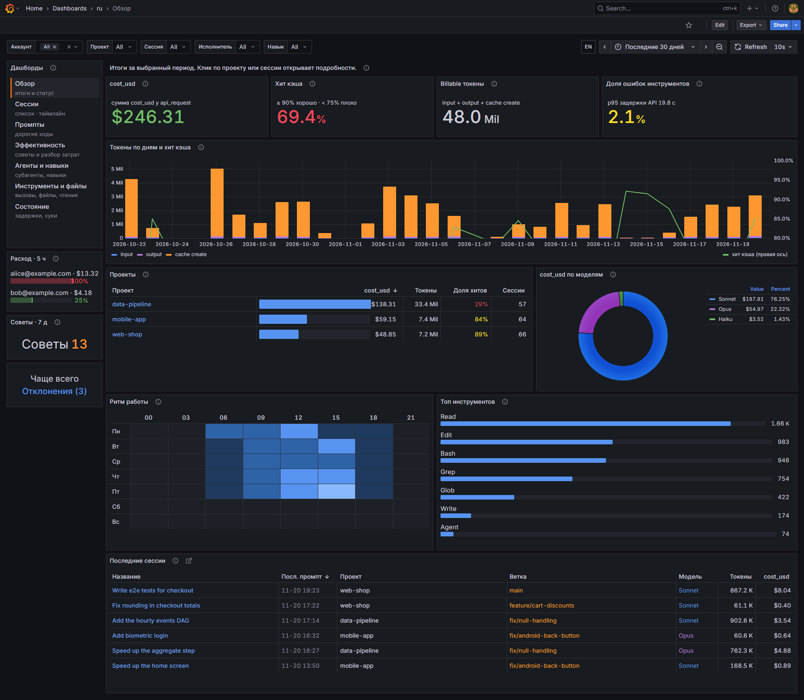
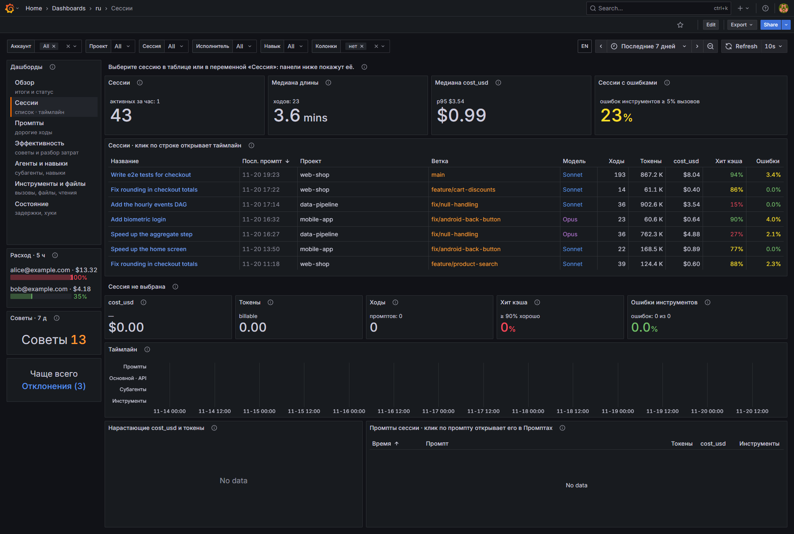
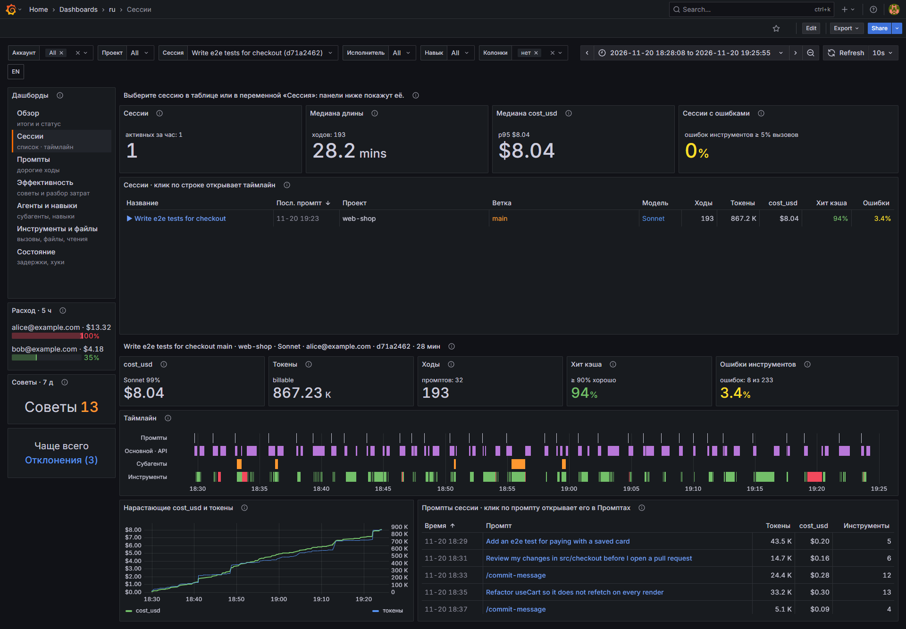
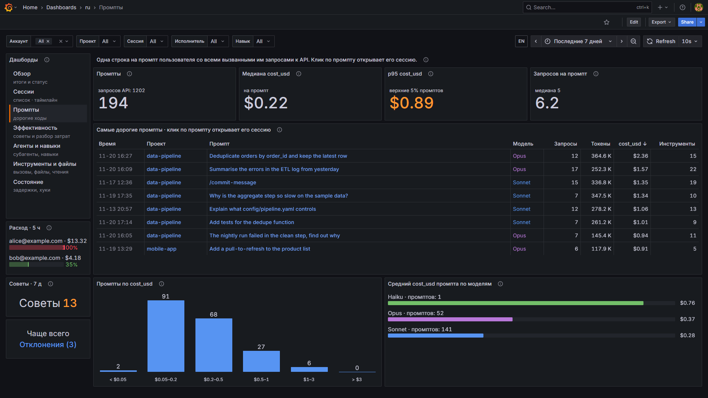
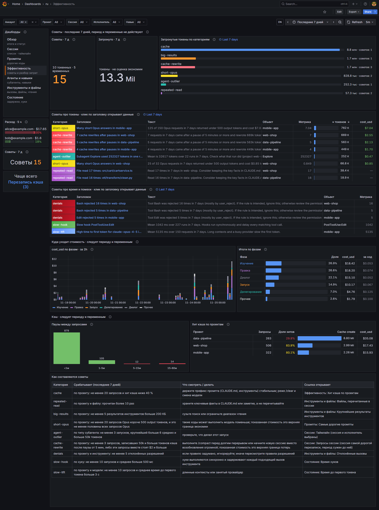
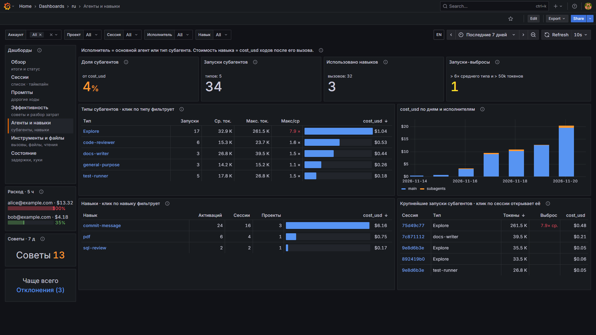
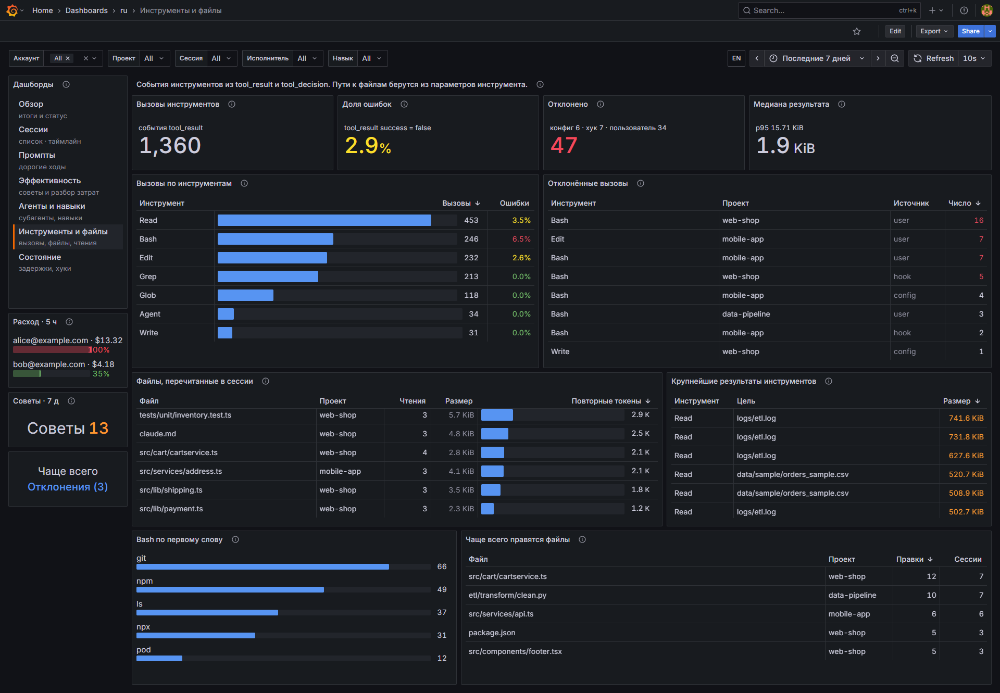
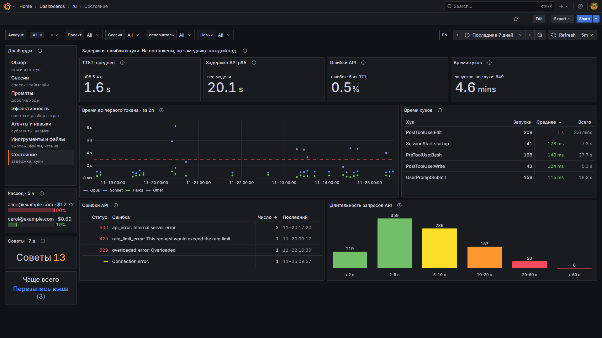

# Чтение дашбордов

Grafana показывает семь дашбордов. Эта страница объясняет, что на них есть, как работают
переменные и период времени и что открывает клик. Экраны рассчитаны на Full HD (1920 px по
ширине) и шире; более узкие экраны не поддерживаются.

!!! note "Названия панелей"
    Таблицы на этой странице приводят названия дашбордов, панелей и переменных так, как они
    названы на русских копиях, см. [Русские дашборды](#русские-дашборды). Английские названия
    есть на английской странице. Некоторые названия заканчиваются подсказкой вроде
    `· клик по типу фильтрует`; в таблицах ниже этот хвост опущен, а клик описан в отдельной
    колонке.

Скриншоты на этой странице показывают выдуманные демонстрационные данные.

---

## Открыть Grafana

Откройте `http://localhost:3000` на серверном ПК или `http://<server-ip>:3000` с другого ПК (с
вашим `GRAFANA_PORT`, если вы его меняли). Войдите как `admin`; пароль — это
`GRAFANA_ADMIN_PASSWORD` в файле `.env` папки `cc-telemetry`, см.
[страницу сервера](server.md#проверка-работы). Домашняя страница — английский **Overview** (его
русская копия — **Обзор**). Пока не пришли первые события, она пуста.

---

## Русские дашборды

У каждого дашборда есть русская копия с теми же панелями, в папке Grafana `ru`. Английские
дашборды остаются в папке General, а домашняя страница — английский **Overview**.

| Что | Поведение |
| --- | --- |
| Переключение | Кнопка **RU** в строке элементов управления вверху открывает русскую копию; **EN** на копии возвращает назад. Период времени и все переменные сохраняются |
| Ссылки | Боковая панель, клики-переходы и ссылки подсказок остаются на том языке, на котором вы находитесь |
| Переведено | Боковая панель, названия переменных и варианты **Колонки**, названия панелей и плиток, описания, заголовки колонок, тексты «нет данных» и значений, подписи, собранные в SQL |
| Не переведено | Названия сессий и другие собранные данные; интерфейс самого Grafana (`All`, меню, единицы); названия и тексты подсказок, они приходят из `cc.tips`; термины вроде `cost_usd`, TTFT и p95; названия инструментов и моделей |

Копии генерируются из английских файлов; не правьте их в Grafana. После обновления старого
сервера Grafana нужно один раз перезапустить, чтобы она подхватила папку `ru`: `--update` на
Linux делает это сам, на Windows следуйте [шагам обновления](maintenance.md#windows).

---

## Боковая панель

Левые 3 из 24 колонок на каждом дашборде — это боковая панель (rail). Её панели имеют
фиксированную высоту, поэтому место под ними остаётся пустым.

| Панель | Что показывает | Что делает клик |
| --- | --- | --- |
| **Дашборды** | Семь дашбордов; текущий выделен | Открывает этот дашборд, период времени и переменные сохраняются |
| **Расход · 5 ч** | Одна полоса на аккаунт Claude: стоимость за последние 5 часов как доля от самой высокой 5-часовой стоимости этого аккаунта за последние 30 дней. Зелёная ниже 60 %, жёлтая от 60 %, красная от 80 %. Аккаунты без стоимости за последние 7 дней не показываются | Ничего |
| **Советы · 7 д** | Число [подсказок](tips.md) | Открывает раздел «Советы» на дашборде **Эффективность** |
| (плитка под ней, без названия) | Самая частая категория подсказок (название переведено, например «Пересборка кэша») и её число в скобках; при равенстве — по алфавиту; `нет`, если подсказок нет | Открывает раздел «Советы» на дашборде **Эффективность** |

Боковая панель игнорирует период времени и переменные: её окна фиксированы (5 часов против
последних 30 дней и 7 дней).

---

## Переменные

Пять переменных вверху общие для всех дашбордов и вложенные: каждая показывает только то, что
осталось после тех, что левее. `All` — без фильтра. При переходе между дашбордами через панель
они сохраняются.

| Переменная | Что фильтрует | Примечания |
| --- | --- | --- |
| **Аккаунт** | Аккаунт Claude | Множественный выбор. Показывает e-mail аккаунта или первые 8 символов его id, если e-mail нет. События без аккаунта видны только при `All` |
| **Проект** | Проект | Метка или догадка, описанная на [странице клиентов](clients.md#проект) |
| **Сессия** | Одна сессия | Показывает `title (short id)` или полный id, пока у сессии нет названия. В списке 300 новейших сессий, сделавших запрос к модели |
| **Исполнитель** | Кто сделал запрос | `main` — основная сессия, имя агента (`developer`, `Explore`, ...) — субагент, `aux:*` — служебные запросы самого Claude Code |
| **Навык** | Используемый навык | Вызов инструмента относится к навыку через `request_id` запроса к модели, который нёс имя навыка. Эту привязку делает сам Claude Code; метка действует до конца промпта, в котором навык был вызван |

На дашборде **Сессии** есть ещё один элемент, **Колонки**: он включает дополнительные колонки
таблицы сессий «ID сессии», «Начало» и «Аккаунт»; по умолчанию выбрано «нет».

Не каждая панель следует каждой переменной:

| Панель | Игнорирует |
| --- | --- |
| Боковая панель | Период времени и все переменные |
| Раздел «Советы» на дашборде **Эффективность** | Период времени и все переменные: подсказки закреплены за последними 7 днями |
| **Последние сессии** на дашборде **Обзор** | Исполнитель и Навык; показывает токены и стоимость сессии целиком |
| Таблица сессий и её четыре итога на дашборде **Сессии** | Переменную Сессия, чтобы выбранная строка оставалась среди остальных |
| Две панели **Время хуков** на дашборде **Состояние** (итог и таблица) | Навык: у событий хуков нет навыка |

Ещё два случая — не «игнорирует», а «пусто»: **Использовано навыков** и **Навыки** на дашборде
**Агенты и навыки** ничего не показывают, пока в переменной Исполнитель выбран агент, потому что
активации навыков сообщает только основная сессия; а панели под шапкой на дашборде **Сессии**
пишут «Сессия не выбрана», пока вы не выберете сессию.

---

## Период и обновление

| Настройка | Значение |
| --- | --- |
| Период по умолчанию | Последние 24 часа |
| Быстрые периоды | Последние 5 минут, Последний час, Последние 24 часа, Последние 7 дней, Последние 30 дней и Всё время (10 лет) |
| Обновление | По умолчанию каждые 5 минут; другую частоту выбирают справа вверху, от 1 минуты до 1 часа |
| Дни и часы | Часовой пояс сервера, в Docker это UTC |

Период времени действует на все панели, кроме боковой панели и подсказок. Панель, которая его
игнорирует, говорит об этом в своём описании (наведите курсор на `i` в её углу).

---

## Клики

Название панели, которое заканчивается на «клик по ... ...», говорит, что делает клик. В
таблице перечислены все ссылки; [подсказки](tips.md) открывают собственные панели-доказательства.

| Дашборд | Вы нажимаете | Что открывается |
| --- | --- | --- |
| **Обзор** | Название сессии в **Последние сессии** | Эта сессия на **Сессии**, период сужен до неё |
| **Обзор** | **все →** рядом с заголовком **Последние сессии** | **Сессии** с текущими периодом и переменными |
| **Обзор** | Проект в **Проекты** | **Обзор**, отфильтрованный по проекту; Сессия, Исполнитель и Навык сбрасываются в `All` |
| **Сессии** | Название сессии в таблице **Сессии** | Эта сессия под таблицей, период сужен до неё; Исполнитель и Навык сохраняются |
| **Сессии** | Промпт в **Промпты сессии** | **Промпты**, отфильтрованный по этой сессии; период остаётся, Исполнитель и Навык сбрасываются в `All` |
| **Промпты** | Промпт в **Самые дорогие промпты** | Его сессия на **Сессии**, период сужен до неё; Исполнитель и Навык сбрасываются в `All` |
| **Промпты** | Проект в **Самые дорогие промпты** | **Промпты**, отфильтрованный по проекту; Аккаунт и Сессия сохраняются, Исполнитель и Навык сбрасываются в `All` |
| **Агенты и навыки** | Тип агента в **Типы субагентов** | **Агенты и навыки**, отфильтрованный по типу (Исполнитель) |
| **Агенты и навыки** | Навык в **Навыки** | **Агенты и навыки**, отфильтрованный по навыку (Навык) |
| **Агенты и навыки** | Сессия в **Крупнейшие запуски субагентов** | Эта сессия на **Сессии**, период сужен до неё; Исполнитель и Навык сбрасываются в `All` |
| **Эффективность** | Название подсказки в **Советы про токены** или **Советы про время и помехи** | Панель-доказательство на весь экран, см. [Подсказки](tips.md#куда-ведут-ссылки) |
| любой дашборд | Две плитки подсказок на боковой панели | Раздел «Советы» на дашборде **Эффективность** |

**Правило сужения.** Если открыть сессию по названию (**Последние сессии**, **Сессии**), по
промпту в **Самые дорогие промпты** или из **Крупнейшие запуски субагентов**, период времени тоже
становится периодом этой сессии: от её первого промпта, запроса или вызова инструмента до конца
последнего, с запасом по 3 % этого отрезка с каждой стороны, не меньше 5 секунд. Тогда
таймлайн и график накопленной стоимости занимают всю ширину, а таблица сессий и её четыре итога
показывают сессии, активные в этом окне. Кнопка «Назад» в браузере или выбор периода возвращают
прежний период. Выбор сессии в переменной Сессия период не сужает: сузьте его сами.

---

## Обзор

**Вопрос:** сколько я потратил и как хорошо работал кэш за этот период?

| Панель | Что показывает | Клик |
| --- | --- | --- |
| **cost_usd** | Сумма `cost_usd` запросов к API за период | - |
| **Хит кэша** | См. определения ниже. По проектам: **Хит кэша по проектам** на дашборде **Эффективность** | - |
| **Billable токены** | Токены input + output + cache create | - |
| **Доля ошибок инструментов** | Доля неудачных вызовов инструментов: ниже 2 % зелёный, от 2 % жёлтый, от 5 % красный. Вторая строка — 95-й перцентиль длительности запроса к API | - |
| **Токены и хит кэша** | Столбцы (левая ось): токены input, output и cache create по интервалам; около 100 интервалов на период, каждый не меньше 5 минут (15 минут за 24 часа, 2 часа за 7 дней, 6 часов за 30 дней). Столбец начинается в начале своего интервала и покрывает его; заголовок панели заканчивается длиной интервала (`за 15m`), заголовок подсказки — начало интервала. Линия (правая ось, 80-100 %): cache hit rate за интервал; меньшее значение обрезается. Чтение кэша не нарисовано: оно в 10-100 раз больше и сплющило бы столбцы | - |
| **Проекты** | По проектам: `cost_usd`, billable tokens, cache hit rate, сессии. `unknown` — проект не удалось определить | Фильтрует **Обзор** по проекту |
| **cost_usd по моделям** | Доля `cost_usd` по семействам моделей (Opus, Sonnet, Haiku; Other — любое другое имя); в легенде доля и доллары | - |
| **Ритм работы** | Запросы по дням недели (строки) и 3-часовым блокам (колонки `00`, `03`, ... `21`). Чем ближе ячейка к самой загруженной, тем она ярче. Это таблица с цветными ячейками, потому что тепловая карта Grafana не умеет выводить время суток по оси X | - |
| **Топ инструментов** | 7 инструментов с наибольшим числом вызовов | - |
| **Последние сессии** | Шесть сессий с самым поздним промптом: название, модель, токены, `cost_usd` всей сессии | Название открывает сессию; **все →** открывает **Сессии** |

| Термин | Значение |
| --- | --- |
| `cost_usd` | Считается самим Claude Code по ценам API, поэтому сумма — не счёт: при подписке вы платите фиксированную цену |
| Billable токены | Input + output + cache create. Чтение кэша не входит: оно стоит малую долю обычного токена |
| Хит кэша (cache hit rate) | cache read / (cache read + input + cache create). 90 % и выше — зелёный, 75 % и выше — жёлтый, ниже — красный |

---

## Сессии

**Вопрос:** что произошло в одной сессии: промпты, запросы, субагенты и инструменты во времени?

Верхняя часть перечисляет сессии и игнорирует переменную Сессия; всё, что ниже, относится к
одной выбранной сессии. Выберите её кликом по названию в таблице или в переменной Сессия.

| Панель | Что показывает | Клик |
| --- | --- | --- |
| **Сессии** (первая плитка) | Сессии с запросом к модели и промптом за период. Строка над числом: сессии, чьё последнее событие было в последний час | - |
| **Медиана длины** | Медианная длина сессии как время активности; строка над числом: медианное число ходов | - |
| **Медиана cost_usd** | Медианный `cost_usd` сессии целиком; строка над числом: 95-й перцентиль | - |
| **Сессии с ошибками** | Доля этих сессий, в которых не менее 5 % вызовов инструментов завершились ошибкой. Сессии целиком, не только период | - |
| **Сессии** (таблица) | Строка на сессию, сначала с самым поздним последним промптом, не более 500: название (заголовок, иначе первый промпт), последний промпт, проект, git-ветка, модель с наибольшей стоимостью, ходы, токены, `cost_usd`, cache hit rate, ошибки инструментов. У выбранной строки перед названием ▶. ID сессии, Начало и Аккаунт скрыты, пока вы не выберете их в переменной **Колонки** | Название выбирает сессию и сужает период |
| (шапка) | Название и ветка, проект, модель с наибольшей стоимостью, аккаунт, короткий id, время активности и `LIVE`, если последнему событию меньше 10 минут | - |
| **cost_usd** | `cost_usd` сессии; строка над числом: семейство модели с наибольшей стоимостью и его доля | - |
| **Токены** | Billable токены сессии | - |
| **Ходы** | Запросы сессии к модели, включая субагентов и служебные; строка над числом: различные промпты, которые их вызвали | - |
| **Хит кэша** | Cache hit rate сессии | - |
| **Ошибки инструментов** | Неудачные вызовы инструментов / вызовы: ниже 2 % зелёный, 2 % жёлтый, от 5 % красный | - |
| **Таймлайн** | Одна ячейка на шаг времени периода; см. ниже | - |
| **Нарастающие cost_usd и токены** | Нарастающий итог по сессии, один шаг на запрос к модели: `cost_usd` на левой оси (зелёный), billable токены на правой (синий) | - |
| **Промпты сессии** | Промпты сессии, сначала самые ранние: токены и вызовы инструментов | Промпт открывается на дашборде **Промпты** |

| Термин | Значение |
| --- | --- |
| Время активности (длина сессии) | Время, в течение которого шёл запрос к модели или вызов инструмента. Простой между ними не считается, а перекрывающиеся запросы и вызовы считаются один раз |
| Ход (turn) | Запрос к модели, включая субагентов и служебные запросы |
| `LIVE` | Последнему событию сессии меньше 10 минут |

**Как читать таймлайн.** Дорожки: Промпты (промпт отмечает один шаг; видны только при Исполнитель и
Навык, равных `All`), Основной · API (шёл запрос основного агента), Субагенты (от первого до
последнего запроса субагента) и Инструменты (зелёный: все вызовы успешны; красный: хотя бы один вызов
в этом шаге завершился ошибкой). Claude Code записывает запрос или вызов инструмента, когда он
заканчивается, поэтому полоса идёт назад от этого момента на его длительность. При широком
периоде полосы тонкие: нажмите на сессию в таблице, чтобы сузить период.

Текст промпта виден, только если клиент задаёт `OTEL_LOG_USER_PROMPTS=1`; иначе панели пишут
`(текст не записан)`.

---

## Промпты

**Вопрос:** какие промпты стоят дороже всего и сколько стоит обычный промпт?

Промпт — это сообщение пользователя и все запросы к API до следующего сообщения пользователя
(включая субагентов и служебные запросы); его `cost_usd` — сумма по этим запросам. Панели
следуют периоду (по времени промпта) и всем переменным; при заданных Исполнитель или Навык считаются
только промпты с таким запросом, по их полной стоимости.

| Панель | Что показывает | Клик |
| --- | --- | --- |
| **Промпты** | Промпты за период, вызвавшие хотя бы один запрос к API; строка над числом: сами запросы | - |
| **Медиана cost_usd** | Медианный `cost_usd` промпта | - |
| **p95 cost_usd** | 95-й перцентиль: 5 % промптов стоят дороже | - |
| **Запросов на промпт** | Среднее число запросов к API на промпт; строка над числом: медиана | - |
| **Самые дорогие промпты** | 8 промптов с наибольшим `cost_usd`: текст, проект, модель (с наибольшей стоимостью внутри промпта), запросы, токены, инструменты | Промпт открывает свою сессию на дашборде **Сессии**; проект фильтрует **Промпты** |
| **Промпты по cost_usd** | Число промптов по диапазонам: < $0.05, $0.05-0.2, $0.2-0.5, $0.5-1, $1-3, > $3 | - |
| **Средний cost_usd промпта по моделям** | Средний `cost_usd` промпта по семействам моделей; промпт относится к семейству с наибольшей стоимостью внутри него. В имени указано, по скольким промптам считается среднее | - |

---

## Эффективность

**Вопрос:** где теряются токены и деньги и какие подсказки относятся к моей работе?

Страница состоит из трёх частей. Раздел «Советы» сверху читает [подсказки](tips.md): они закреплены
за последними 7 днями, без периода времени и без переменных. Разделы «Куда уходит стоимость» и
«Кэш» ниже следуют периоду времени и переменным.

| Панель | Что показывает | Клик |
| --- | --- | --- |
| **Советы · 7 д** | Число подсказок, затем сколько из них о токенах и сколько о времени (denials, slow hooks, slow first token). Её двойник на боковой панели называется так же | - |
| **Затронуто · 7 д** | Сумма токенов, о которых говорят подсказки; оценка масштаба, а не экономии | - |
| **Затронутые токены по категориям** | Та же сумма по категориям, сначала самые большие; у подсказок о времени значения нет, их здесь нет | - |
| **Советы про токены** | Подсказки о токенах, сначала самые большие: категория, заголовок, затронутые токены, `cost_usd` | Заголовок открывает панель-доказательство |
| **Советы про время и помехи** | Подсказки без значения в токенах (denials, slow hooks, slow first token) | Заголовок открывает панель-доказательство |
| **cost_usd по фазам** | Столбцы с накоплением: `cost_usd` по интервалам, разбитый по фазе работы ответа. Интервалы зависят от периода (около 100, каждый не меньше 5 минут: 15 минут за 24 часа, 2 часа за 7 дней, 6 часов за 30 дней). Столбец начинается в начале своего интервала и покрывает его; заголовок панели заканчивается длиной интервала (`за 15m`), заголовок подсказки — начало интервала | - |
| **Итоги по фазам** | Те же фазы: доля `cost_usd` периода и `cost_usd` на запрос к модели | - |
| **Паузы между запросами** | Столбчатая диаграмма пауз между подряд идущими запросами к модели одной сессии и одного агента. Больше 5 минут — красный | - |
| **Хит кэша по проектам** | По проектам: запросы, cache hit rate, токены cache creation (во сколько обходится низкий hit rate), `cost_usd` | - |
| **Как составляются советы** | Таблица правил, та же, что на [странице подсказок](tips.md#правила) | - |

| Термин | Значение |
| --- | --- |
| Фаза работы (work phase) | Определяется инструментами, которые вызвал ответ; побеждает первое совпадение в таком порядке: Правка (любой из `Edit`, `Write`, `MultiEdit`, `NotebookEdit`), Делегирование (`Task`, `Agent`, `SendMessage`, `SubagentHandback`, `TaskStop`), Запуск (`Bash`), Изучение (только `Read`, `Grep`, `Glob`, `LS`), Прочее (любые другие инструменты, например MCP, веб или `Skill`). Ответ без результата инструмента — Диалог: обычный ответ или вызов инструмента, результат которого не записан |
| Пауза больше 5 минут | После истечения жизни кэша промпта следующий запрос пишет кэш заново вместо чтения |
| Промежуток (gap) | До предыдущего запроса той же сессии и того же агента: основной разговор (со служебными запросами) и каждый субагент считаются отдельно, паузы между запросами основного разговора и субагента не учитываются. Предыдущий запрос ищется во всей истории сессии, поэтому пауза перед первым запросом периода учитывается; первый запрос субагента паузой не является |

---

## Агенты и навыки

**Вопрос:** сколько стоят субагенты и навыки и какие запуски выбиваются из нормы?

| Панель | Что показывает | Клик |
| --- | --- | --- |
| **Доля субагентов** | Доля `cost_usd`, потраченная субагентами (запросы с `agent_id`), среди всех запросов | - |
| **Запуски субагентов** | Завершённые запуски субагентов и число типов агентов среди них | - |
| **Использовано навыков** | Различные активированные навыки и число активаций. `0`, если в Исполнитель выбран агент | - |
| **Запуски-выбросы** | Запуски по правилу выбросов ниже. Зелёный, если их нет, жёлтый, если есть хотя бы один | - |
| **Типы субагентов** | По типам агентов: запуски, среднее и максимум токенов за запуск, максимум к среднему (выше 4 — жёлтый, выше 6 — красный), `cost_usd`; сортировка по `cost_usd` | Фильтрует дашборд по типу (Исполнитель) |
| **cost_usd по исполнителям** | `cost_usd` по интервалам: субагенты против main (основная сессия и служебные запросы). Интервалы зависят от периода (около 100, каждый не меньше 5 минут: 15 минут за 24 часа, 2 часа за 7 дней, 6 часов за 30 дней). Столбец начинается в начале своего интервала и покрывает его; заголовок панели заканчивается длиной интервала (`за 15m`), заголовок подсказки — начало интервала | - |
| **Навыки** | По навыкам: активации, сессии и проекты, `cost_usd` ходов после вызова навыка до конца промпта | Фильтрует дашборд по навыку (Навык) |
| **Крупнейшие запуски субагентов** | 5 завершённых запусков с наибольшим числом токенов за период: сессия, тип агента, токены, `cost_usd`; выброс отмечен красным | Открывает сессию на дашборде **Сессии**, период сужен |

| Термин | Значение |
| --- | --- |
| Запуск-выброс (outlier run) | Запуск больше чем в 6 раз выше среднего своего типа агента и больше 50 000 токенов. Это правило подсказки `agent-outlier` ([подсказки](tips.md#правила)), но считается за период времени и с переменными, а не за последние 7 дней |

---

## Инструменты и файлы

**Вопрос:** какие инструменты падают или отклоняются, какие файлы перечитываются и правятся чаще всего?

| Панель | Что показывает | Клик |
| --- | --- | --- |
| **Вызовы инструментов** | Число вызовов инструментов за период | - |
| **Доля ошибок** | Доля неудачных вызовов; отклонённый вызов считается неудачным. Ниже 2 % зелёный, от 2 % жёлтый, от 5 % красный | - |
| **Отклонено** | Отклонённые вызовы с разбивкой, кто отклонил: конфиг (правила разрешений), хук, пользователь. Зелёный, если нет, красный от одного | - |
| **Медиана результата** | Медианный размер того, что инструмент вернул модели; строка над числом: 95-й перцентиль. Телеметрия содержит байты, а не токены (около 4 байт на токен) | - |
| **Вызовы по инструментам** | 7 инструментов с наибольшим числом вызовов и их доля ошибок | - |
| **Отклонённые вызовы** | Отклонения по инструменту, проекту и источнику. Счётчики от 5 красные; цель подсказки `denials` | - |
| **Файлы, перечитанные в сессии** | Файлы, прочитанные больше двух раз за сессию: чтения, средний размер, Повторные токены; пути относительно проекта; не более 50 строк. Цель подсказки `repeated-read` | - |
| **Крупнейшие результаты инструментов** | 50 самых больших результатов, возвращённых модели; от 1 MiB размер красный. Цель подсказки `big-results` | - |
| **Bash по первому слову** | 5 самых частых первых слов команд Bash | - |
| **Чаще всего правятся файлы** | 5 файлов, изменяемых чаще всего (`Edit`, `MultiEdit`, `Write`, `NotebookEdit`), с числом сессий | - |

| Термин | Значение |
| --- | --- |
| Повторные токены (repeat tokens) | Примерно размер / 4 x (чтения - 1): токены, которые добавили повторные чтения. Оценка, то же эмпирическое правило, что и в подсказках |
| Bash по первому слову | Claude Code отправляет только первое слово команды (`git`, `cd`), поэтому это не подсчёт повторяющихся команд |

---

## Состояние

**Вопрос:** насколько быстро и надёжно работают запросы к API и хуки?

| Панель | Что показывает | Клик |
| --- | --- | --- |
| **TTFT, среднее** | Среднее время до первого токена; вторая строка: 95-й перцентиль. Красный выше 3 с | - |
| **Задержка API p95** | 95-й перцентиль полной длительности запроса к модели, все модели вместе | - |
| **Ошибки API** | Неудачные попытки запросов к модели (повторы включены) как доля запросов к модели | - |
| **Время хуков** | Суммарное время в ваших хуках; вторая строка: число запусков. Игнорирует Навык | - |
| **Время до первого токена** | Медианное время до первого токена по интервалам и семействам моделей, точками (не соединены; интервал без запросов семейства ничего не показывает). Пунктирная красная линия — 3 с, порог подсказки `slow-ttft`; сама подсказка считает среднее по проекту и модели за 7 дней, поэтому точка ниже 3 с её не исключает. Интервалы зависят от периода (около 100, каждый не меньше 5 минут: 15 минут за 24 часа, 2 часа за 7 дней, 6 часов за 30 дней). Точка нарисована в начале интервала; заголовок панели заканчивается длиной интервала (`за 15m`). Цель подсказки `slow-ttft` | - |
| **Время хуков** (таблица) | По хукам: запуски, средняя и суммарная длительность; среднее выше 200 мс — жёлтое, выше 500 мс — красное. Игнорирует Навык. Цель подсказки `slow-hook` | - |
| **Ошибки API** (таблица) | Неудачные запросы по HTTP-статусу и тексту ошибки (первые 100 символов) со временем последней; не более 50 строк. Прочерк — ошибка без статуса, например сетевая | - |
| **Длительность запросов API** | Запросы по полной длительности: зелёный до 5 с, жёлтый до 10 с, оранжевый до 20 с, выше — красный | - |

Панели **Ошибки API** остаются пустыми, пока не придёт первое событие `api_error`. Запрос, который
упал и был повторён, считается каждый раз. Хуки работают синхронно, поэтому медленный хук
задерживает каждый вызов инструмента, к которому он относится.

→ О том, что дашборды могут подсказать сами, см. [страницу подсказок](tips.md).
