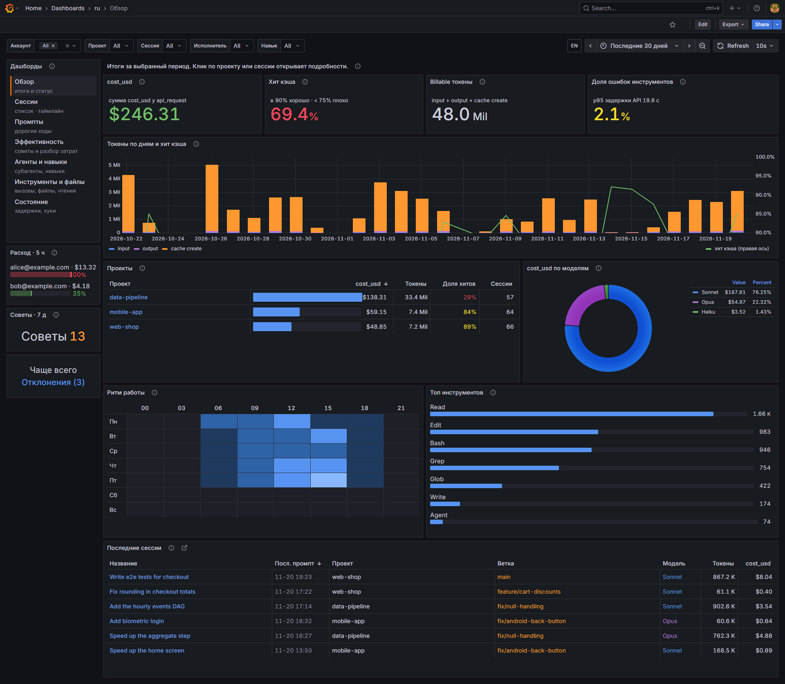

# cc-telemetry

cc-telemetry показывает, как вы используете Claude Code: стоимость, токены, сессии, промпты,
инструменты, субагентов и ошибки. Claude Code отправляет телеметрию на серверный ПК в вашей
локальной сети, где она хранится и отображается в Grafana. Сама телеметрия остаётся на этом сервере: у коллектора нет экспортёра,
кроме ClickHouse. Сама Grafana по умолчанию обращается к grafana.com, см.
[Данные и приватность](data.md#где-лежат-данные).

Это руководство описывает версию {{ app_version }}.

## Как идут данные

```text
Claude Code (каждый ПК) ─ OTLP gRPC :4317 ─┐
session hook            ─ OTLP HTTP :4318 ─┤
                                           ▼
        OTel Collector ─► ClickHouse ─► Grafana :3000
```

Claude Code экспортирует события сам, поэтому клиентскому ПК нужны только настройки, без
дополнительных программ. Небольшой хук, который ставит клиентский скрипт, добавляет названия
сессий и git-ветки. Нужен Claude Code **2.1.310 или новее**: в старых версиях события
инструментов не содержат `agent_id`.

## На какие вопросы отвечают дашборды

Grafana показывает семь дашбордов. Панель слева на каждом из них переключает между ними и
сохраняет период времени и переменные.

| Дашборд | На какой вопрос отвечает |
| --- | --- |
| **Обзор** | Сколько я потратил и как работал кэш за период, по дням, проектам и моделям? |
| **Сессии** | Что произошло в одной сессии: промпты, запросы, субагенты и инструменты во времени? |
| **Промпты** | Какие промпты стоят дороже всего и сколько стоит обычный промпт? |
| **Эффективность** | Где теряются токены и деньги и какие подсказки относятся к моей работе? |
| **Агенты и навыки** | Сколько стоят субагенты и навыки и какие запуски выбиваются из нормы? |
| **Инструменты и файлы** | Какие инструменты падают или отклоняются, какие файлы перечитываются и правятся чаще всего? |
| **Состояние** | Насколько быстро и надёжно работают запросы к API и хуки? |

[](assets/ru/overview.png)

## Поддерживаемые платформы

| Роль | Windows | Linux |
| --- | --- | --- |
| Сервер (один раз) | скрипт PowerShell, Docker Engine в WSL2 | скрипт bash, Docker Engine |
| Клиент (каждый ПК) | скрипт PowerShell | скрипт bash |

Сервер и клиенты общаются только по OTLP поверх TCP, поэтому подходит любое сочетание,
например сервер на Linux и клиенты на Windows.

## С чего начать

| Вы хотите | Куда идти |
| --- | --- |
| Установить сервер | [Сервер](server.md) |
| Подключить ПК | [Клиенты](clients.md) |
| Прочитать дашборд | [Дашборды](dashboards.md) |
| Исправить упавший шаг | [Решение проблем](troubleshooting.md) |
| Обновить, сохранить или остановить сервер | [Обслуживание](maintenance.md) |
| Узнать, что собирается | [Данные и приватность](data.md) |
| Посмотреть, что даёт текущая версия | [Примечания к выпуску](release-1-0-0.md) |

!!! note "Языки"
    Это руководство есть на английском и русском; язык переключается в шапке. У каждого
    дашборда есть и русская копия, она открывается кнопкой **RU**, см.
    [Русские дашборды](dashboards.md#русские-дашборды). Русские страницы этого руководства
    приводят названия дашбордов и панелей так, как они названы на русских копиях.
